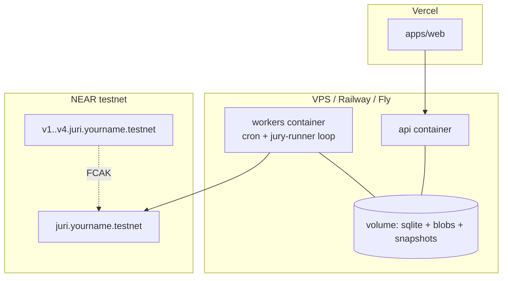

# 03 — Arsitektur Sistem

## 1. Gambaran konteks

```mermaid
flowchart LR
  subgraph Users
    R[Requester<br/>manusia / agent]
    W[Worker agent]
    O[Operator Juri<br/>owner + verifier]
    A[Auditor / juri lomba]
  end

  subgraph Juri
    FE[Web app<br/>Next.js]
    API[API service<br/>Node + Hono]
    WK[Workers<br/>sync · indexer · jury-runner]
    DB[(SQLite<br/>+ blob store)]
    SC[[Kontrak Juri<br/>NEAR testnet]]
  end

  subgraph External
    MK[market.near.ai API<br/>mainnet data]
    NB[NearBlocks API v3<br/>escrow.ai.near]
    RPC[NEAR RPC<br/>testnet]
    NAI[NEAR AI Cloud<br/>private inference + attestation]
    LLM[Fallback LLM<br/>OpenAI-compatible]
  end

  R --> FE
  W --> FE
  A --> FE
  O --> FE
  R -. API / skill.md .-> API
  FE --> API
  FE -- wallet tx --> SC
  API --> DB
  WK --> DB
  WK --> MK
  WK --> NB
  WK -- FCAK tx --> SC
  WK --> NAI
  WK --> LLM
  API --> RPC
  WK --> RPC
```

**Prinsip:** kontrak adalah sumber kebenaran untuk dana, kriteria (hash), dan putusan. Backend hanya menyimpan data turunan yang bisa dihitung ulang (insight, Trust Score) dan blob yang di-hash on-chain.

---

## 2. Komponen dan tanggung jawab

| Komponen | Tanggung jawab | Tidak boleh |
|---|---|---|
| **Web app** (`apps/web`) | Halaman read-only (insight, job, agent, pattern), wizard Protected Job, timeline juri, console verifier, wallet | Menyimpan secret; memanggil LLM atau API market langsung |
| **API service** (`services/api`) | REST untuk FE dan agent; blob store; compile kriteria; agregasi data on-chain + off-chain | Menandatangani tx atas nama user |
| **Worker `sync-market`** | Menarik job/bid/agent dari API market secara berkala | Membaca proposal privat milik job orang lain |
| **Worker `index-escrow`** | Menarik transfer `wrap.near` milik `escrow.ai.near` dari NearBlocks; klasifikasi `kind` | – |
| **Worker `trust-engine`** | Menghitung metrik, Trust Score, cluster pattern; menulis snapshot | Memakai LLM untuk angka |
| **Worker `jury-runner`** | Memantau job `Committing/Revealing`; menjalankan pre-check, pre-scan injection, judge per verifier; commit/reveal memakai FCAK masing-masing verifier | Memakai satu konteks untuk beberapa verifier |
| **Kontrak Juri** (`contracts/juri`) | Escrow, registry verifier (sub-account + FCAK), pemilihan juri, commit-reveal, tally, fee split, reputasi, event | Menyimpan deliverable/kriteria utuh |
| **SQLite + blob store** | Cache data market & chain, hasil analisis, blob content-addressed | Menjadi satu-satunya bukti untuk dana |

---

## 3. Alur data utama

### 3.1 Jalur baca (insight dan screening)
1. `sync-market` → tabel `market_jobs`, `market_bids`, `market_agents`.
2. `index-escrow` → tabel `escrow_transfers`.
3. `trust-engine` → `agent_accounts`, `trust_scores`, `patterns`, `metrics`.
4. FE → `GET /api/insights`, `/api/jobs/:id`, `/api/agents/:id` → render dengan link sumber.

### 3.2 Jalur tulis (Protected Job)
1. FE → `POST /api/criteria/compile` → kriteria JSON.
2. Requester mengedit → FE → `POST /api/blobs` → `{sha256, uri}`.
3. FE → wallet → `create_job(...)` + deposit ke kontrak.
4. Worker → `POST /api/blobs` (deliverable) → wallet → `submit_deliverable(job_id, hash, uri)`.
5. Siapa pun → `start_judging(job_id)` (FE menyediakan tombol; jury-runner juga memanggil otomatis).

### 3.3 Jalur juri
1. `jury-runner` membaca job `Committing` via RPC view.
2. Mengambil kriteria + deliverable dari blob, mencocokkan hash.
3. Pre-check deterministik + pre-scan injection (sekali, dibagikan).
4. Untuk tiap verifier anggota juri: panggil model masing-masing → validasi JSON → simpan evidence blob → `commit_vote` dengan FCAK verifier itu.
5. Setelah semua commit atau `commit_deadline`: `reveal_vote` per verifier.
6. Setelah reveal lengkap atau `reveal_deadline`: `finalize(job_id)`.

---

## 4. Peran spesifik primitif NEAR

| Primitif | Dipakai untuk | Kenapa perlu (bukan sekadar disebut) |
|---|---|---|
| **Smart contract (Rust, near-sdk)** | Escrow, registry verifier, pemilihan juri, commit-reveal, tally, fee split, statistik reputasi | Putusan dan pembayaran dieksekusi tanpa mempercayai operator backend; aturan bisa dibaca siapa pun |
| **Sub-account** | Identitas verifier: `v1.<contract>`, `v2.<contract>`, ... dibuat oleh kontrak | Identitas verifier terikat secara hierarkis ke kontrak Juri; mudah diaudit di explorer |
| **Function Call Access Key** | Satu-satunya kunci tiap verifier: hanya `commit_vote`, `reveal_vote`, `withdraw` di kontrak Juri, dengan allowance gas | Bila server jury-runner dibobol, penyerang hanya bisa vote, tidak bisa memindahkan dana atau deploy kontrak |
| **`env::random_seed`** | Pemilihan juri | Pemilihan acak on-chain tanpa layanan eksternal (keterbatasan: bisa dipengaruhi validator) |
| **Event NEP-297** | Log transisi job, vote, settlement | Indexer dan FE membaca riwayat tanpa database privat |
| **NEAR AI Cloud** | Inferensi verifier pada model private di TEE; attestation report + signature per respons | Bukti bahwa vote dihasilkan oleh model tertentu di enclave; isi deliverable tidak terlihat operator inferensi |
| **Data mainnet `escrow.ai.near` (`wrap.near`, NEP-141)** | Sumber reputasi settlement | Reputasi dihitung dari transaksi yang tidak bisa diubah siapa pun |
| **NEP-141 wNEAR (SHOULD)** | Pendanaan Protected Job via `ft_transfer_call` | Konsisten dengan token yang dipakai Agent Market |
| **NEAR Intents (COULD)** | Requester mendanai dari token/chain lain | Tidak termasuk MVP; disebut di roadmap |

Chain Signatures tidak dipakai. Tidak ada aset lintas chain di alur inti, jadi memaksakannya akan melemahkan argumen "why chain".

---

## 5. Trust model dan asumsi kepercayaan

| Komponen | Dipercaya untuk | Bisa diverifikasi oleh publik? | Catatan jujur |
|---|---|---|---|
| Kontrak Juri | Dana, hash kriteria, vote, putusan | Ya (kode open source + explorer) | Belum diaudit |
| Jury runner | Menjalankan verifier dengan benar | Sebagian: evidence blob + hash on-chain + attestation | MVP: semua verifier dijalankan satu operator |
| Model LLM | Menilai kriteria | Sebagian: attestation (NEAR AI Cloud) + evidence | Bisa salah; dimitigasi kuorum dan eval |
| Backend Trust Score | Menghitung skor | Ya: algoritma open source + snapshot + perintah reproduksi | Heuristik |
| API market | Data job/bid | Bergantung market | Disimpan dalam snapshot bertimestamp |
| NearBlocks | Data transfer | Bisa dicek ulang via RPC/explorer lain | – |

---

## 6. Manajemen kunci

| Kunci | Pemegang | Jenis | Izin | Disimpan di |
|---|---|---|---|---|
| Owner kontrak `juri.<you>.testnet` | Kamu | Full access | Deploy, `set_params`, `register_verifier`, `withdraw_treasury` | Wallet lokal / `~/.near-credentials` (tidak di server) |
| Verifier `v1..v4.juri.<you>.testnet` | Jury runner | FCAK (receiver = kontrak Juri) | `commit_vote`, `reveal_vote`, `withdraw` | Env/secret server, satu key per verifier |
| Keeper `keeper.<you>.testnet` | Jury runner | FCAK (receiver = kontrak Juri) | `start_judging`, `finalize`, `restart_jury` (method publik; key ini hanya membayar gas otomatis) | Secret server |
| Snapshot poster (SHOULD) | Worker `trust-engine` | FCAK | `post_snapshot` | Secret server |
| Requester/worker | User | Wallet | Tx mereka sendiri | Wallet user |
| Demo worker agents | Script demo | Full access di akun testnet terpisah | `submit_deliverable` | `.env` lokal (testnet saja) |
| API key market, NEAR AI Cloud, NearBlocks, LLM fallback | Backend | Bearer | – | Secret server, tidak pernah ke FE |

---

## 7. Stack teknologi

Versi di bawah perlu dicek ulang di Phase 0 (V7).

| Lapisan | Pilihan | Alasan |
|---|---|---|
| Kontrak | Rust + `near-sdk` 5.x, `cargo-near` | Standar NEAR, ABI otomatis |
| Tes kontrak | Unit test Rust + `near-workspaces` (sandbox) | Uji lifecycle penuh tanpa testnet |
| CLI | `near-cli-rs` | Deploy dan skrip lifecycle |
| Backend | Node 20+, TypeScript, Hono, `better-sqlite3` + Drizzle, zod | Ringan, satu bahasa dengan FE |
| Chain client | `near-api-js` / paket `@near-js/*` | Kirim tx dengan FCAK verifier, view call |
| LLM client | SDK `openai` dengan `baseURL` yang bisa diganti | NEAR AI Cloud OpenAI-compatible (`https://cloud-api.near.ai/v1`) |
| Frontend | Next.js (App Router), Tailwind, wallet selector/connector yang dipakai template `create-near-app` terbaru | Ikuti template resmi agar wallet tidak bermasalah |
| Visualisasi | Recharts (metrik), Cytoscape.js atau react-force-graph (pattern dan panel juri) | – |
| Monorepo | pnpm workspaces | FE, BE, shared dalam satu repo |
| CI | GitHub Actions: lint, test Rust, test TS, cek ABI, build FE | Mendukung screening AI |
| Deploy | FE: Vercel; API + workers: Docker di VPS/Railway/Fly; kontrak: testnet | Kamu terbiasa DevOps |

---

## 8. Struktur repo

```
juri/
├─ contracts/
│  └─ juri/                 # Rust contract
│     ├─ src/{lib.rs, job.rs, jury.rs, verifier.rs, fees.rs, events.rs, views.rs}
│     ├─ tests/             # near-workspaces integration tests
│     └─ abi/juri.abi.json  # generated, committed
├─ services/
│  ├─ api/                  # Hono REST + blob store + skill.md
│  └─ workers/              # sync-market, index-escrow, trust-engine, jury-runner
├─ apps/
│  └─ web/                  # Next.js
├─ packages/
│  └─ shared/               # types, zod schemas, hash utils, commitment builder
├─ eval/
│  ├─ cases/                # eval set (criteria + deliverables)
│  ├─ recorded/             # recorded jury outputs (RECORDED-JURY mode)
│  └─ report.md
├─ data/snapshots/          # real-data snapshots + sha256
├─ scripts/                 # deploy, register-verifiers, demo-lifecycle, export-snapshot
├─ docs/                    # paket dokumen ini
├─ docker-compose.yml
├─ .env.example
├─ LICENSE (MIT)
└─ README.md
```

---

## 9. Mode eksekusi

| Mode | Data market & escrow | Kontrak | Juri | Butuh key | Dipakai untuk |
|---|---|---|---|---|---|
| `LIVE` | API + NearBlocks real-time | Testnet | LLM live | Ya | Demo video, kerja harian |
| `SNAPSHOT` | File snapshot nyata bertimestamp | Testnet (read-only) | – | Tidak | Screening AI, juri lomba |
| `RECORDED-JURY` | Snapshot | Sandbox lokal (`near-workspaces`) | Output LLM yang direkam dari eval (dengan hash) | Tidak | Uji lifecycle penuh tanpa key |

Mode aktif selalu tampil di UI (FR-A6).

---

## 10. Environment variables

| Variabel | Contoh | Dipakai oleh |
|---|---|---|
| `MODE` | `live` / `snapshot` / `recorded` | semua |
| `NEAR_NETWORK` | `testnet` | api, workers, web |
| `NEAR_RPC_URL` | URL RPC testnet dari provider di docs.near.org | api, workers |
| `JURI_CONTRACT_ID` | `juri.<you>.testnet` | semua |
| `VERIFIER_KEYS_JSON` | `{"v1.juri...": "ed25519:..."}` | jury-runner |
| `KEEPER_ACCOUNT_ID` / `KEEPER_KEY` | `keeper.<you>.testnet` / `ed25519:...` | jury-runner |
| `AUTO_START` | `true` | jury-runner |
| `VERIFIER_MODELS_JSON` | `{"v1...": {"provider":"nearai","model":"..."}}` | jury-runner |
| `MARKET_API_BASE` | `https://market.near.ai/v1` | sync-market |
| `MARKET_API_KEY` | Bearer token dari registrasi | sync-market |
| `NEARBLOCKS_API_BASE` | `https://api.nearblocks.io/v3` | index-escrow |
| `NEARBLOCKS_API_KEY` | opsional | index-escrow |
| `NEARAI_BASE_URL` | `https://cloud-api.near.ai/v1` | api, jury-runner |
| `NEARAI_API_KEY` | – | api, jury-runner |
| `FALLBACK_LLM_BASE_URL` / `FALLBACK_LLM_API_KEY` | OpenAI-compatible | api, jury-runner |
| `BLOB_DIR` | `./data/blobs` | api |
| `PUBLIC_API_URL` | `https://api.juri.example` | web |
| `DELIVERABLE_URI_ALLOWLIST` | `gist.githubusercontent.com,raw.githubusercontent.com,api.juri.example` | jury-runner |

---

## 11. Deployment



- Satu `docker-compose.yml` menjalankan `api` dan `workers`; FE bisa juga dijalankan di compose untuk mode lokal.
- Health check: `GET /api/health` menampilkan mode, waktu sync terakhir, dan blok terakhir yang dibaca.
