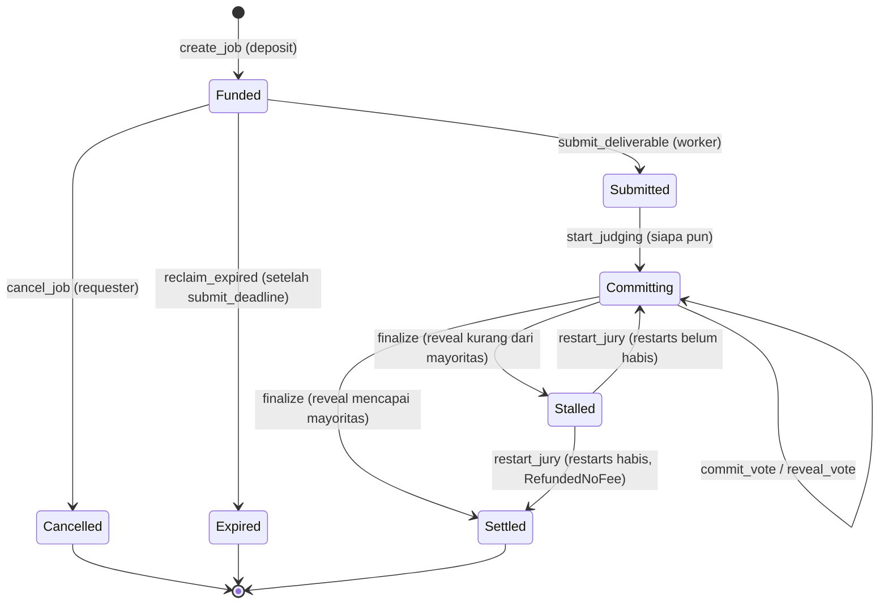

# 04 — Spesifikasi Smart Contract Juri

Bahasa: Rust, `near-sdk` 5.x (cek versi di Phase 0). Kode di bawah adalah **spesifikasi/pseudo-code**, bukan kode yang pasti compile. Nama method dan argumen di sini menjadi kontrak antarmuka untuk BE dan FE; ubah di sini dulu sebelum mengubah kode.

---

## 1. Akun

| Akun | Peran |
|---|---|
| `juri.<you>.testnet` | Akun kontrak; owner = `<you>.testnet` |
| `v1.juri.<you>.testnet` … `v4.juri.<you>.testnet` | Verifier; dibuat oleh kontrak; hanya punya FCAK |
| `demo-worker-honest.<you>.testnet`, `demo-worker-injector.<you>.testnet` | Worker agent untuk demo |
| `demo-requester.<you>.testnet` | Requester untuk demo dan skrip agent |
| `keeper.<you>.testnet` | Membayar gas untuk `start_judging`, `finalize`, `restart_jury` secara otomatis (FCAK) |

---

## 2. Tipe data

```rust
// Verdict per kriteria
pub const FAIL: u8 = 0;
pub const PASS: u8 = 1;
pub const UNSURE: u8 = 2;

// Jenis kriteria
pub const MUST: u8 = 0;
pub const SHOULD: u8 = 1;

#[near(serializers = [borsh, json])]
pub enum JobStatus { Funded, Submitted, Committing, Stalled, Settled, Cancelled, Expired }
// Catatan: fase "reveal" tidak punya status sendiri; reveal diizinkan bila semua juri sudah commit
// atau commit_deadline sudah lewat (lihat §5).

#[near(serializers = [borsh, json])]
pub enum Outcome { Released, Refunded, Split, RefundedNoFee }

#[near(serializers = [borsh, json])]
pub enum PayoutMode { Binary, Partial { base_pct: u8 } } // Partial = SHOULD

#[near(serializers = [borsh, json])]
pub struct Reveal {
    pub verifier: AccountId,
    pub verdicts: Vec<u8>,              // panjang = jumlah kriteria; nilai 0/1/2
    pub injection_flag: bool,
    pub evidence_hash: String,          // sha256 hex dari blob evidence JSON
    pub attestation_hash: Option<String>,
    pub model: String,                  // label model, mis. "nearai:<model-id>"
}

#[near(serializers = [borsh, json])]
pub struct Job {
    pub id: u64,
    pub requester: AccountId,
    pub worker: AccountId,
    pub amount: U128,                   // escrow bersih (setelah biaya storage)
    pub criteria_hash: String,          // sha256 hex (64 char)
    pub criteria_uri: String,           // ≤512 char
    pub criteria_kinds: Vec<u8>,        // 0=MUST, 1=SHOULD; 1..=max_criteria; minimal 1 MUST
    pub market_job_id: Option<String>,  // ID job di market.near.ai (opsional)
    pub payout_mode: PayoutMode,
    pub created_at: u64,                // ns
    pub submit_deadline: u64,           // ns
    pub deliverable_hash: Option<String>,
    pub deliverable_uri: Option<String>,
    pub submitted_at: Option<u64>,
    pub jury: Vec<AccountId>,
    pub commit_deadline: u64,
    pub reveal_deadline: u64,
    pub restarts: u8,
    pub commits: Vec<(AccountId, String)>, // (verifier, commitment hex)
    pub reveals: Vec<Reveal>,
    pub status: JobStatus,
    pub outcome: Option<Outcome>,
    pub criteria_result: Vec<u8>,       // hasil tally per kriteria (0/1)
    pub injection_flagged: bool,        // true bila ≥1 revealer menandai injection
}

#[near(serializers = [borsh, json])]
pub struct Verifier {
    pub account_id: AccountId,
    pub payout_account: AccountId,
    pub model_label: String,
    pub stake: U128,
    pub active: bool,
    pub votes: u32,
    pub majority_agreements: u32,
    pub missed_reveals: u32,
    pub earned: U128,
}

#[near(serializers = [borsh, json])]
pub struct AgentStats {
    pub worker_settled: u32,
    pub worker_passed: u32,
    pub worker_failed: u32,
    pub worker_earned: U128,
    pub requester_jobs: u32,
}

#[near(serializers = [borsh, json])]
pub struct Params {
    pub fee_bps: u16,                // default 300 (3%)
    pub jury_share_bps: u16,         // default 8000 (80% dari fee)
    pub jury_size: u8,               // 3 (atau 5)
    pub commit_secs: u32,            // demo 180, produksi 3600
    pub reveal_secs: u32,            // demo 180
    pub min_stake: U128,             // 1 NEAR
    pub verifier_seed_balance: U128, // 0.5 NEAR untuk gas verifier
    pub min_amount: U128,            // 0.1 NEAR
    pub max_criteria: u8,            // 13 (C0 + 12)
    pub max_restarts: u8,            // 1
}
```

### State kontrak

```rust
#[near(contract_state)]
pub struct Contract {
    owner: AccountId,
    params: Params,
    next_job_id: u64,
    jobs: IterableMap<u64, Job>,
    verifiers: IterableMap<AccountId, Verifier>,
    claimable: LookupMap<AccountId, u128>,
    treasury: u128,
    agent_stats: LookupMap<AccountId, AgentStats>,
    snapshot_poster: Option<AccountId>,     // SHOULD
    snapshots: Vector<SnapshotRoot>,        // SHOULD
}
```

---

## 3. State machine Protected Job



---

## 4. Method

### 4.1 Owner

| Method | Payable | Prasyarat | Efek | Event | Error |
|---|---|---|---|---|---|
| `new(owner_id, params)` | – | `#[init]` | Inisialisasi state | – | E15 |
| `register_verifier(name, public_key, payout_account, model_label)` | Ya, ≥ `min_stake + verifier_seed_balance` | Owner; `name` = `[a-z0-9-]{1,16}`; belum ada | Promise: `create_account("{name}.{contract}")` → `transfer(seed)` → `add_access_key_allowance(public_key, allowance, contract_id, "commit_vote,reveal_vote,withdraw")`; callback `on_verifier_created` menyimpan Verifier (stake = deposit − seed) atau mengembalikan dana ke `claimable[owner]` bila gagal | `verifier_registered` | E01, E13, E20 |
| `set_verifier_active(account_id, active)` | – | Owner | Ubah status aktif | `verifier_updated` | E01 |
| `set_params(params)` | – | Owner; `fee_bps ≤ 1000`; `jury_share_bps ≤ 10000`; `jury_size ∈ {3,5}`; window 60–86400 dtk | Ganti params (job yang sudah berjalan memakai deadline yang sudah tersimpan) | `params_updated` | E01, E15 |
| `withdraw_treasury(amount, to)` | – | Owner; `amount ≤ treasury` | Transfer | `treasury_withdrawn` | E01, E16 |
| `set_snapshot_poster(account_id)` (SHOULD) | – | Owner | Simpan poster | – | E01 |

> Cek di Phase 0 (V7): signature `Promise::add_access_key_allowance` pada versi near-sdk yang dipakai, dan bentuk `Allowance` (limited vs unlimited). Allowance gas yang disarankan: 0,25 NEAR per verifier; isi ulang dengan mendaftarkan ulang key bila habis.

### 4.2 Requester dan worker

| Method | Payable | Pemanggil | Prasyarat | Efek | Event | Error |
|---|---|---|---|---|---|---|
| `create_job(worker, criteria_hash, criteria_uri, criteria_kinds, submit_deadline_secs, market_job_id, payout_mode)` → `u64` | Ya | Requester | `worker ≠ requester`; hash 64 hex; `criteria_kinds` 1..=max dan ≥1 MUST; `submit_deadline_secs` 60..=30 hari; deposit − biaya storage ≥ `min_amount` | Simpan Job (`Funded`); `amount = deposit − biaya storage`; `agent_stats[requester].requester_jobs += 1` | `job_created` | E11, E13, E17, E18, E19 |
| `cancel_job(job_id)` | – | Requester | `Funded` | `claimable[requester] += amount`; `Cancelled` | `job_cancelled` | E02, E05 |
| `submit_deliverable(job_id, deliverable_hash, deliverable_uri)` | – | Worker | `Funded`; `now ≤ submit_deadline` | Simpan hash, uri, `submitted_at`; `Submitted` | `deliverable_submitted` | E03, E05, E06, E17, E18 |
| `reclaim_expired(job_id)` | – | Siapa pun | `Funded`; `now > submit_deadline` | `claimable[requester] += amount`; `Expired` | `job_expired` | E05, E07 |
| `ft_on_transfer(sender_id, amount, msg)` (SHOULD) | – | Kontrak token yang diizinkan | `msg` = JSON argumen `create_job` | Seperti `create_job` dengan token | `job_created` | – |

**Biaya storage:** ukur `env::storage_usage()` sebelum dan sesudah menyimpan Job, kalikan `env::storage_byte_cost()`, lalu kurangkan dari deposit. Storage untuk commit/reveal ditanggung saldo kontrak (dibatasi ≤5 juri dan panjang string), sehingga owner perlu menjaga saldo kontrak ≥ 5 NEAR di testnet.

### 4.3 Juri

| Method | Pemanggil | Prasyarat | Efek | Event | Error |
|---|---|---|---|---|---|
| `start_judging(job_id)` | Siapa pun | `Submitted` | Pilih juri (§6); `commit_deadline = now + commit_secs`; `reveal_deadline = commit_deadline + reveal_secs`; `Committing` | `jury_selected` | E05, E14 |
| `commit_vote(job_id, commitment)` | Anggota juri (via FCAK) | `Committing`; `now ≤ commit_deadline`; belum commit | Simpan commitment | `vote_committed` | E04, E05, E06, E08, E17 |
| `reveal_vote(job_id, verdicts, injection_flag, evidence_hash, salt, attestation_hash, model)` | Anggota juri yang sudah commit | `Committing`; (semua juri sudah commit **atau** `now > commit_deadline`); `now ≤ reveal_deadline`; belum reveal | Cek panjang dan nilai verdicts; cek commitment (§5); simpan Reveal | `vote_revealed` | E04, E05, E06, E09, E10, E12 |
| `finalize(job_id)` | Siapa pun | `Committing`; (semua yang commit sudah reveal **dan** semua juri sudah commit) **atau** `now > reveal_deadline` | Tally (§7) → `Settled` atau `Stalled`; update statistik; `missed_reveals += 1` untuk juri yang tidak reveal | `job_settled` / `job_stalled` | E05, E07 |
| `restart_jury(job_id)` | Siapa pun | `Stalled` | Bila `restarts < max_restarts`: juri baru (kecualikan yang tidak reveal bila kandidat cukup), reset commits/reveals, `restarts += 1`, `Committing`. Bila habis: `claimable[requester] += amount`, `Outcome::RefundedNoFee`, `Settled` | `jury_selected` / `job_settled` | E05, E14 |
| `withdraw()` | Siapa pun | `claimable[caller] > 0` | Set claimable ke 0 lalu transfer. Tujuan: `payout_account` bila caller adalah verifier; selain itu caller. Callback `on_withdraw` mengembalikan saldo bila transfer gagal | `withdrawn` | E16 |

### 4.4 Snapshot reputasi (SHOULD)

| Method | Pemanggil | Efek |
|---|---|---|
| `post_snapshot(root, computed_at, algo_version, source_hash)` | `snapshot_poster` | Tambah `SnapshotRoot` ke vektor; event `snapshot_posted` |

### 4.5 View

| Method | Return |
|---|---|
| `get_params()` | `Params` |
| `get_job(job_id)` | `Option<Job>` |
| `get_jobs(from_index, limit)` | `Vec<Job>` (limit ≤ 50) |
| `get_jobs_by_account(account_id, role: "requester"\|"worker", from_index, limit)` | `Vec<Job>` |
| `get_verifier(account_id)` / `get_verifiers()` | `Option<Verifier>` / `Vec<Verifier>` |
| `get_claimable(account_id)` | `U128` |
| `get_treasury()` | `U128` |
| `get_agent_stats(account_id)` | `AgentStats` |
| `get_snapshots(limit)` (SHOULD) | `Vec<SnapshotRoot>` |

---

## 5. Format commitment

Agar Rust dan TypeScript menghasilkan hash yang identik, commitment dihitung dari string UTF-8:

```
commitment = hex( sha256( "{job_id}|{verifier_id}|{verdicts_csv}|{inj}|{evidence_hash}|{salt_hex}" ) )
```

- `job_id`: desimal, mis. `7`
- `verifier_id`: mis. `v2.juri.alice.testnet`
- `verdicts_csv`: mis. `1,1,0,2`
- `inj`: `1` atau `0`
- `evidence_hash`: sha256 hex huruf kecil dari blob evidence
- `salt_hex`: 32 byte acak dalam hex (64 char), dibuat dan disimpan jury-runner sampai reveal

Contoh vektor uji (wajib ada di `packages/shared` dan di unit test Rust):

```
input:  "7|v2.juri.alice.testnet|1,1,0,2|0|<64-hex>|<64-hex>"
output: dihitung sekali, di-commit sebagai fixture, dan dicek di kedua bahasa
```

`attestation_hash` dan `model` tidak masuk commitment karena attestation bisa diambil setelah penilaian. Keduanya tetap disimpan saat reveal.

---

## 6. Pemilihan juri

```
fn select_jury(job, exclude: &[AccountId]) -> Vec<AccountId>:
    let mut cand = active verifiers
        .filter(|v| v != job.requester && v != job.worker && !exclude.contains(v))
    if cand.len() < jury_size && !exclude.is_empty():
        cand = active verifiers tanpa filter exclude (tetap tanpa requester/worker)
    require(cand.len() >= jury_size, E14)
    // Fisher–Yates dengan sumber acak deterministik per job
    let mut seed = sha256(env::random_seed() || job.id.to_le_bytes() || [job.restarts])
    for i in (1..cand.len()).rev():
        let j = (u64_from(seed[0..8]) % (i as u64 + 1)) as usize
        cand.swap(i, j)
        seed = sha256(seed)
    return cand[0..jury_size]
```

Keterbatasan (diakui di README): `random_seed` bisa dipengaruhi validator; dengan 4 verifier milik satu operator, pemilihan acak terutama berfungsi sebagai demonstrasi mekanisme.

---

## 7. Algoritma tally dan settlement

```
let n = job.jury.len()                       // jury_size
let majority = n / 2 + 1                     // 3 → 2, 5 → 3
let k = job.criteria_kinds.len()
if job.reveals.len() < majority:
    status = Stalled; for v in jury not revealed: missed_reveals += 1; emit job_stalled; return

// 1) Hasil per kriteria: PASS bila jumlah PASS ≥ majority (UNSURE dihitung bukan PASS)
for i in 0..k:
    passes = count(r in reveals where r.verdicts[i] == PASS)
    result[i] = if passes >= majority { 1 } else { 0 }

must_ok = all(result[i] == 1 for i where kinds[i] == MUST)
should_total = count(kinds == SHOULD); should_pass = count(kinds == SHOULD && result == 1)

outcome = if !must_ok { Refunded }
          else if payout_mode is Partial && should_total > 0 { Split }
          else { Released }

// 2) Fee
fee       = amount * fee_bps / 10_000
jury_pool = fee * jury_share_bps / 10_000
net       = amount - fee

// 3) Bagian verifier proporsional terhadap kesepakatan dengan hasil
for r in reveals:
    agree[r] = count(i in 0..k where (r.verdicts[i] == PASS) == (result[i] == 1))
sum_agree = Σ agree
if sum_agree == 0: treasury += fee
else:
    for r in reveals:
        share = jury_pool * agree[r] / sum_agree
        claimable[r.verifier] += share; verifier.earned += share
    treasury += fee - Σ share                 // sisa pembulatan ikut ke treasury
for r in reveals:
    verifier.votes += 1
    if agree[r] * 2 > k: verifier.majority_agreements += 1

// 4) Pembayaran
match outcome:
    Released => claimable[worker] += net
    Refunded => claimable[requester] += net
    Split    => w = net * (base_pct*100 + (100-base_pct) * should_pass * 100 / should_total) / 10_000
                claimable[worker] += w; claimable[requester] += net - w

// 5) Statistik
agent_stats[worker].worker_settled += 1
if outcome in {Released, Split}: worker_passed += 1; worker_earned += (net atau w)
else: worker_failed += 1
job.injection_flagged = any(r.injection_flag)
status = Settled; emit job_settled
```

### Contoh angka

Escrow 10 NEAR, `fee_bps` 300, `jury_share_bps` 8000, 5 kriteria (3 MUST, 2 SHOULD), mode Binary.

| Langkah | Nilai |
|---|---|
| Fee | 0,30 NEAR |
| Jury pool | 0,24 NEAR |
| Treasury (sebelum sisa pembulatan) | 0,06 NEAR |
| Net | 9,70 NEAR |
| Kesepakatan v1, v2, v3 | 5, 5, 3 (total 13) |
| Bagian v1, v2, v3 | ≈0,0923; ≈0,0923; ≈0,0554 NEAR |
| Semua MUST lolos | Worker menerima 9,70 NEAR |
| Ada MUST gagal | Requester menerima kembali 9,70 NEAR |

Cancel, Expired, dan RefundedNoFee tidak memotong fee.

---

## 8. Event (NEP-297)

Prefix log: `EVENT_JSON:`. `standard = "juri"`, `version = "1.0.0"`.

| Event | `data` |
|---|---|
| `verifier_registered` | `{ account_id, payout_account, model_label, stake }` |
| `verifier_updated` | `{ account_id, active }` |
| `job_created` | `{ job_id, requester, worker, amount, criteria_hash, criteria_kinds, market_job_id, submit_deadline }` |
| `job_cancelled` / `job_expired` | `{ job_id }` |
| `deliverable_submitted` | `{ job_id, deliverable_hash, deliverable_uri }` |
| `jury_selected` | `{ job_id, jury, commit_deadline, reveal_deadline, restarts }` |
| `vote_committed` | `{ job_id, verifier }` |
| `vote_revealed` | `{ job_id, verifier, verdicts, injection_flag, evidence_hash, attestation_hash, model }` |
| `job_stalled` | `{ job_id, revealed, required }` |
| `job_settled` | `{ job_id, outcome, criteria_result, fee, jury_pool, net, injection_flagged }` |
| `withdrawn` | `{ account_id, to, amount }` |
| `params_updated` / `treasury_withdrawn` / `snapshot_posted` | sesuai argumen |

---

## 9. Kode error

| Kode | Pesan | Kode | Pesan |
|---|---|---|---|
| E01 | NotOwner | E11 | InvalidCriteria |
| E02 | NotRequester | E12 | InvalidVerdicts |
| E03 | NotWorker | E13 | InsufficientDeposit |
| E04 | NotJuror | E14 | NotEnoughVerifiers |
| E05 | InvalidStatus | E15 | InvalidParams |
| E06 | DeadlinePassed | E16 | NothingToWithdraw |
| E07 | DeadlineNotReached | E17 | InvalidHash |
| E08 | AlreadyCommitted | E18 | StringTooLong |
| E09 | NotCommitted | E19 | SelfDealing |
| E10 | CommitmentMismatch | E20 | VerifierExists |

Pakai `env::panic_str("E10: CommitmentMismatch")` agar FE bisa memetakan kode ke pesan yang ramah.

---

## 10. Checklist keamanan kontrak

- [ ] Semua method privileged mengecek `env::predecessor_account_id()`.
- [ ] State diubah **sebelum** membuat Promise; `withdraw` memakai callback `#[private]` untuk mengembalikan saldo bila transfer gagal.
- [ ] Aritmetika `u128` memakai `checked_mul`/`checked_div`; tidak ada pembagian dengan nol (`sum_agree`, `should_total`).
- [ ] Panjang string dan vektor dibatasi (DoS storage).
- [ ] `finalize` idempoten: status `Settled` menolak panggilan ulang.
- [ ] Verifier tidak bisa menjadi juri pada job di mana ia requester/worker.
- [ ] Callback `on_verifier_created` hanya bisa dipanggil kontrak sendiri (`#[private]`).
- [ ] FCAK verifier tidak mencakup method owner atau `create_job`.
- [ ] Waktu memakai `env::block_timestamp()` (ns); deadline disimpan dalam ns.
- [ ] Upgrade: tidak ada fungsi upgrade di MVP (redeploy ke akun baru bila perlu); catat di README.

---

## 11. Rencana pengujian kontrak

**Unit test (Rust):**
1. `create_job` valid dan setiap cabang error (E11, E13, E17, E18, E19).
2. `cancel_job` hanya requester dan hanya saat `Funded`.
3. `submit_deliverable` sebelum dan sesudah deadline.
4. `reclaim_expired` sebelum dan sesudah deadline.
5. Commitment: vektor uji cocok; reveal dengan salt salah → E10.
6. Tally: semua PASS; satu MUST gagal; UNSURE; kasus "tiap verifier gagal di kriteria berbeda" (hasil tetap PASS per kriteria); `sum_agree == 0`.
7. Fee split: jumlah share + treasury + net = amount (tidak ada wei yang hilang).
8. Stall → restart → settle; stall dua kali → RefundedNoFee.
9. `withdraw` ke `payout_account` untuk verifier.
10. `set_params` di luar batas → E15.

**Integration test (near-workspaces):**
1. Deploy, `register_verifier` ×4 → cek sub-account ada dan access key-nya FCAK dengan method yang benar.
2. Lifecycle penuh: create → submit → start → 3 commit → 3 reveal → finalize → withdraw (worker dan verifier).
3. Verifier mencoba memanggil `create_job` atau `withdraw_treasury` dengan FCAK → ditolak oleh runtime.
4. Stall path dengan satu verifier tidak reveal.

---

## 12. Skrip lifecycle (contoh, near-cli-rs)

Sintaks near-cli-rs perlu dicek di Phase 0. Pola umumnya:

```bash
near contract call-function as-transaction juri.<you>.testnet create_job \
  json-args '{"worker":"demo-worker-honest.<you>.testnet","criteria_hash":"<64hex>","criteria_uri":"https://api.juri.example/blobs/<64hex>","criteria_kinds":[0,0,0,1,1],"submit_deadline_secs":3600,"market_job_id":"a3672345-513b-4840-a4ae-44c1e03eb5c0","payout_mode":"Binary"}' \
  prepaid-gas '100.0 Tgas' attached-deposit '5 NEAR' \
  sign-as demo-requester.<you>.testnet network-config testnet sign-with-keychain send
```

Skrip `scripts/demo-lifecycle.ts` menjalankan seluruh alur memakai `near-api-js` agar bisa dipakai di CI dan oleh screening AI.

---

## 13. Addendum implementasi P3 (freeze #2, 2026-11-13)

**Status:** diterima owner sebagai freeze #2 (2026-11-13). Parameter demo di bawah dipertahankan; gas verifier 30 Tgas adalah batas tetap untuk jury runner (commit/reveal memakai <10 Tgas, jadi seed 0,1 NEAR cukup untuk ±10 vote per verifier sebelum perlu top-up).

Sumber kebenaran antarmuka: `contracts/juri/abi/juri.abi.json` dan `packages/shared/src/contract.ts` (test `contract.test.ts` memastikan keduanya sinkron). Perbedaan terhadap §2–§9:

- **Timestamp** di `Job`/`Verifier`/`SnapshotRoot` diserialisasi sebagai `U64` (string JSON, nanodetik), bukan number.
- **Commit** disimpan sebagai `Vec<Commit { verifier, commitment }>`; reveal sebagai `Vec<Reveal>`.
- **Settlement** tersimpan di job setelah `finalize`: `{ fee, jury_pool, net, to_worker, to_requester, to_treasury, shares: [{ verifier, agree, amount }] }`.
- **Kode error tambahan:** `E21 AlreadyRevealed`, `E22 JobNotFound`, `E23 VerifierNotFound`.
- **`new(owner_id, params: Option<Params>)`**: tanpa `params` memakai default §2; `set_params` memvalidasi lewat `Params::is_valid`.
- **ID job mulai dari 1** (0 tidak pernah dipakai).
- **View tambahan:** `get_jobs(from_index, limit)`, `get_jobs_by_account`, `get_job_count`, `get_verifiers`, `get_claimable`, `get_treasury`, `get_totals`, `get_agent_stats`, `get_snapshots`, `get_owner`.
- **`create_job`**: biaya storage dihitung dari selisih `storage_usage` (setelah flush koleksi) dan dipotong dari deposit; `amount = deposit − storage_cost ≥ min_amount`.
- **Parameter demo testnet** (`scripts/deploy.ts`): `verifier_stake` 0,05 NEAR, seed verifier 0,1 NEAR, `min_amount` 0,1 NEAR, window commit/reveal 180 s. Nilai produksi tetap default §2.
- **Gas verifier:** key verifier membayar gas dari saldo seed; prepaid 100 Tgas (≈0,1 NEAR) menghabiskan seed sehingga panggilan verifier memakai **30 Tgas**. Jury runner P4 wajib memakai batas yang sama atau menaikkan seed.
- **RPC testnet:** `rpc.testnet.near.org` mengembalikan -429 (deprecated); default `https://test.rpc.fastnear.com`.
- Belum: `ft_on_transfer` (wNEAR, SHOULD) dan integration test near-workspaces (§11 butir integrasi dibuktikan lewat lifecycle testnet, lihat devlog).
