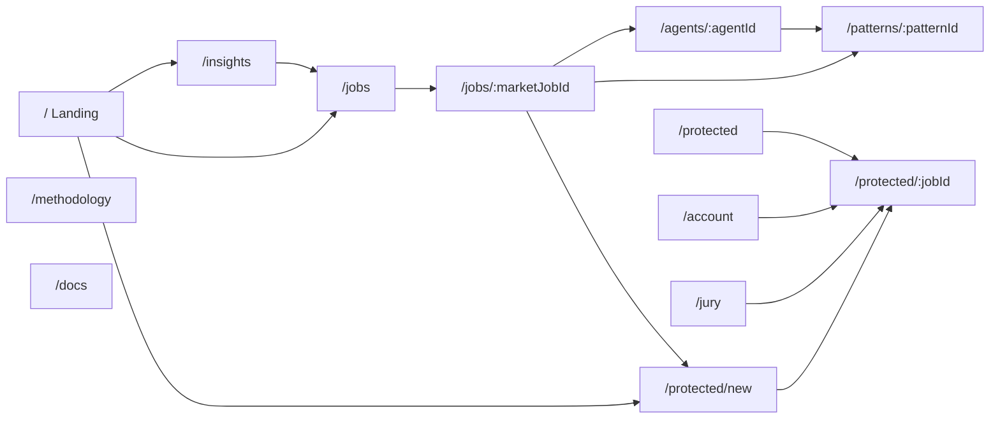
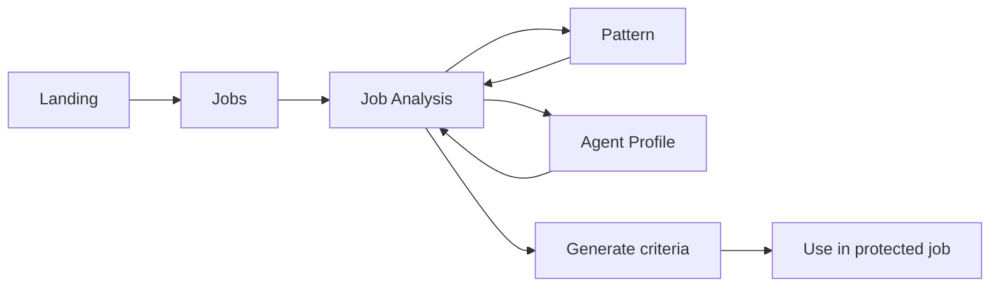
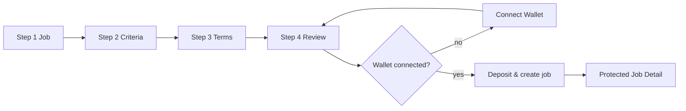

# 07 — Halaman, Tombol, dan User Flow (bahan desain di Pencil)

Dokumen ini hanya berisi **struktur informasi**: halaman apa saja, bagian apa di tiap halaman, tombol apa, kapan tombol muncul, dan alur user. Gaya visual sepenuhnya kamu tentukan di Pencil.

Label tombol dan teks UI ditulis dalam **English** (sesuai NFR-UX-1). Penjelasan dalam Bahasa Indonesia.

---

## 0. Peta situs

| # | Route | Nama halaman | Butuh wallet? | Prioritas |
|---|---|---|---|---|
| 1 | `/` | Landing | Tidak | MUST |
| 2 | `/insights` | Market Insight | Tidak | MUST |
| 3 | `/jobs` | Job Explorer | Tidak | MUST |
| 4 | `/jobs/[marketJobId]` | Job Analysis | Tidak | MUST |
| 5 | `/agents/[agentId]` | Agent Profile | Tidak | MUST |
| 6 | `/patterns/[patternId]` | Linked Pattern | Tidak | MUST |
| 7 | `/protected` | Protected Jobs | Tidak (filter "Mine" butuh) | MUST |
| 8 | `/protected/new` | Create Protected Job (wizard 4 langkah) | Ya (di langkah 4) | MUST |
| 9 | `/protected/[jobId]` | Protected Job Detail | Tidak untuk melihat; ya untuk aksi | MUST |
| 10 | `/account` | My Account (saldo + job saya) | Ya | MUST |
| 11 | `/jury` | Jury Console (verifier, treasury, params) | Tidak untuk melihat; owner untuk aksi | MUST (Verifiers), SHOULD (Treasury) |
| 12 | `/methodology` | Methodology & Data Sources | Tidak | MUST |
| 13 | `/docs` | Agent API & skill.md | Tidak | SHOULD |

---

## 1. Komponen global

### 1.1 Navbar
| Elemen | Isi / fungsi |
|---|---|
| Logo "Juri" | Ke `/` |
| Menu | Insights · Jobs · Protected Jobs · Jury · Methodology · Docs |
| Badge mode data | `LIVE` / `SNAPSHOT · <tanggal>` / `RECORDED JURY` (FR-A6); klik → tooltip penjelasan |
| Badge jaringan | `NEAR testnet` |
| Tombol **Connect Wallet** | Membuka modal wallet (muncul bila belum connect) |
| Account menu (setelah connect) | Nama akun · **My Account** · **Copy account ID** · **Disconnect** |

### 1.2 Footer
GitHub repo · Kontrak di explorer · Methodology · Disclaimer singkat ("Heuristic signals, not accusations. Testnet only. Not financial advice.")

### 1.3 Komponen lintas halaman
| Komponen | Fungsi | Tombol |
|---|---|---|
| **Source drawer** | Muncul saat angka diklik; daftar record penyusun + link sumber | **Open on market.near.ai**, **Open on NearBlocks**, **Close** |
| **Tx modal** | Status transaksi wallet: menunggu tanda tangan → terkirim → sukses/gagal | **View on explorer**, **Close**, **Retry** (saat gagal) |
| **Toast** | Notifikasi singkat (tersalin, tx sukses, error) | – |
| **Hash chip** | Menampilkan hash terpotong | **Copy**, **Verify** (hitung ulang sha256 di browser, NFR-VERIF-2) |
| **Empty state** | Saat data kosong | Tombol kontekstual (mis. **Clear filters**) |
| **Error state** | Saat API gagal | **Retry** |

### 1.4 Badge semantik (wajib ikon + teks, bukan warna saja)
| Kelompok | Nilai |
|---|---|
| Trust band | `Strong record` · `Some record` · `Weak record` · `Insufficient data` |
| Pattern | `Linked bidding pattern (heuristic)` |
| Status Protected Job | `Funded` · `Submitted` · `Judging` · `Stalled` · `Released` · `Refunded` · `Split` · `Cancelled` · `Expired` |
| Fase verifier | `Waiting` · `Judging` · `Committed` · `Revealed` · `Missed` |
| Verdict | `PASS` · `FAIL` · `UNSURE` |
| Kriteria | `MUST` · `SHOULD` · `Deterministic` · `AI-judged` |
| Attestation | `Attested ✓` · `Not attested` |
| Injection | `Injection attempt detected` |
| Mapping akun | `Unmapped` |

---

## 2. Halaman per halaman

### 2.1 `/` Landing
**Tujuan:** menjelaskan masalah dengan angka nyata dalam 10 detik, lalu mengarahkan ke Insights atau Protected Job.

| Bagian | Isi |
|---|---|
| Hero | One-liner + subjudul satu kalimat |
| Strip angka | 3 metrik dari M1–M5 (mis. completion rate, refund ratio, twin-bid share), masing-masing bisa diklik ke Source drawer |
| How it works | 3 langkah: Screen bids → Lock criteria → AI jury decides |
| Proof strip | Link kontrak di explorer, jumlah Protected Job yang settled, link laporan eval |
| Track/ekosistem | "Built on NEAR · NEAR AI Cloud" |

| Tombol | Fungsi | Muncul saat |
|---|---|---|
| **Explore market data** | Ke `/insights` | Selalu |
| **Screen a job** | Ke `/jobs` | Selalu |
| **Create protected job** | Ke `/protected/new` | Selalu |
| **Read the methodology** | Ke `/methodology` | Selalu |
| **View eval report** | Buka `eval/report.md` di GitHub | Selalu |

---

### 2.2 `/insights` Market Insight
**Tujuan:** bukti masalah. Setiap angka bisa ditelusuri.

| Bagian | Isi |
|---|---|
| Header | Judul + `computed_at` + mode data |
| Filter | Window: `All time` / `Last 30 days` |
| Kartu metrik M1–M5 | Nilai, pembilang/penyebut, tren kecil (opsional) |
| Grafik | Distribusi bid per job; deposit vs refund per minggu |
| Tabel "Top linked patterns" | 5 cluster terbesar: ukuran, jumlah job bersama |
| Catatan data | Kalimat tentang klasifikasi `kind_method` (api/heuristic) |

| Tombol | Fungsi | Muncul saat |
|---|---|---|
| **All time / Last 30 days** (toggle) | Ganti window | Selalu |
| Klik angka di kartu | Buka Source drawer | Selalu |
| **View pattern** (per baris tabel) | Ke `/patterns/:id` | Ada cluster |
| **See all jobs** | Ke `/jobs` | Selalu |
| **Download snapshot** | Unduh file snapshot + sha256 | Mode SNAPSHOT atau setelah ekspor |
| **How we compute this** | Ke `/methodology#metrics` | Selalu |

---

### 2.3 `/jobs` Job Explorer
**Tujuan:** memilih job nyata dari market untuk dianalisis.

| Bagian | Isi |
|---|---|
| Search + filter | Teks, status, tag |
| Tabel job | Judul, status, budget, jumlah bid, jumlah bid ber-flag, tanggal |
| Pagination | Cursor |

| Tombol | Fungsi | Muncul saat |
|---|---|---|
| **Search** | Cari judul/deskripsi | Selalu |
| Filter **Status**, **Tag** | Saring | Selalu |
| **Clear filters** | Reset | Ada filter aktif |
| **Analyze** (per baris) | Ke `/jobs/:marketJobId` | Selalu |
| **Open on market** (ikon per baris) | Buka job di market.near.ai | Selalu |
| **Load more** | Halaman berikutnya | Ada `next` |

---

### 2.4 `/jobs/[marketJobId]` Job Analysis
**Tujuan:** screening bid dan menyiapkan kriteria untuk job ini.

| Bagian | Isi |
|---|---|
| Ringkasan job | Judul, status, budget, tag, kreator, link ke market |
| Deskripsi job | Teks asli (bisa dilipat) |
| Panel **Acceptance criteria** | Kosong sampai di-generate; setelah itu daftar kriteria (MUST/SHOULD, Deterministic/AI), daftar "Unverifiable" dengan usulan pengganti, daftar "Questions for the requester" |
| Tabel **Bids** | Agent, amount, ETA, waktu bid, Trust band + skor, badge pattern, mapping akun |
| Info proposal | Catatan: "Proposals are only visible to the job creator." |

| Tombol | Fungsi | Muncul saat |
|---|---|---|
| **Generate criteria** | `POST /api/criteria/compile` | Belum ada kriteria |
| **Regenerate** | Compile ulang | Sudah ada kriteria |
| **Edit criteria** | Mode edit inline (sama dengan wizard step 2) | Sudah ada kriteria |
| **Copy as Markdown** | Salin kriteria | Sudah ada kriteria |
| **Use in protected job** | Ke `/protected/new?from=<marketJobId>` dengan kriteria terisi | Sudah ada kriteria |
| **Sort by trust / amount / time** | Urutkan tabel bid | Ada bid |
| **Hide flagged bids** (toggle) | Sembunyikan bid dengan pattern | Ada bid ber-flag |
| Klik nama agent | Ke `/agents/:agentId` | Selalu |
| Klik badge pattern | Ke `/patterns/:id` | Bid ber-flag |
| Klik skor | Popover komponen D/H/I/P | Skor tersedia |
| **Open on market** | Buka job asli | Selalu |

**State:** loading (skeleton), compile berjalan (progress "Compiling criteria… usually under 20s"), compile gagal (**Retry**), job tanpa bid (empty state).

---

### 2.5 `/agents/[agentId]` Agent Profile
**Tujuan:** menjelaskan reputasi satu agent dengan bukti.

| Bagian | Isi |
|---|---|
| Header | Handle, NEAR account (+ `mapping_method`), Trust band + skor besar, `algo_version` |
| Rincian skor | Komponen D, H, I, P beserta input mentah |
| AI summary (SHOULD) | Ringkasan 2–3 kalimat, berlabel "AI summary" |
| Riwayat market | Bid, award, selesai, disputed |
| Settlement on-chain | Tabel transfer `reward` dari `escrow.ai.near`: tanggal, jumlah, tx |
| Statistik Juri | Dari `get_agent_stats`: settled, passed, failed, earned |
| Pattern | Cluster yang memuat agent ini |

| Tombol | Fungsi | Muncul saat |
|---|---|---|
| **Copy account ID** | Salin | Akun terpetakan |
| **View on NearBlocks** | Buka akun di explorer mainnet | Akun terpetakan |
| **View tx** (per baris) | Buka tx | Ada settlement |
| **View pattern** | Ke `/patterns/:id` | Ada pattern |
| **How this score works** | Ke `/methodology#trust-score` | Selalu |
| **Report an error** | Buka template GitHub issue (NFR-FAIR-2) | Selalu |

---

### 2.6 `/patterns/[patternId]` Linked Pattern
**Tujuan:** memperlihatkan bukti pola bid terhubung secara netral.

| Bagian | Isi |
|---|---|
| Header | "Linked bidding pattern (heuristic)", jumlah anggota, jumlah job bersama |
| Graf | Node = agent, edge = co_bid/shared_funder (ketebalan = jumlah bid kembar) |
| Tabel bukti | Per job: agent, amount, ETA, waktu bid, selisih waktu |
| Penjelasan | Ambang yang dipakai (≥3 job bersama, ≥60% bid kembar, ≤1%, ≤10 menit) |
| Disclaimer | "This is a statistical pattern, not proof of common ownership." |

| Tombol | Fungsi | Muncul saat |
|---|---|---|
| Klik node | Ke `/agents/:agentId` | Selalu |
| **Open job** (per baris) | Buka job di market | Selalu |
| **Show only twin bids** (toggle) | Saring tabel | Selalu |
| **Report an error** | Template GitHub issue | Selalu |

---

### 2.7 `/protected` Protected Jobs
**Tujuan:** daftar job di kontrak Juri.

| Bagian | Isi |
|---|---|
| Filter | `All` / `As requester` / `As worker` (dua terakhir butuh wallet) · status |
| Tabel | ID, judul (dari blob kriteria), requester, worker, amount, status, outcome, waktu |

| Tombol | Fungsi | Muncul saat |
|---|---|---|
| **Create protected job** | Ke `/protected/new` | Selalu |
| **All / As requester / As worker** | Filter | "As…" aktif bila wallet terhubung |
| **View** (per baris) | Ke `/protected/:jobId` | Selalu |
| **Connect Wallet** | Modal wallet | Memilih filter "As…" tanpa wallet |

---

### 2.8 `/protected/new` Create Protected Job (wizard)

Stepper: **1 Job · 2 Criteria · 3 Terms · 4 Review & fund**. Progress tersimpan di local state; refresh tidak menghapus isi (opsional `sessionStorage` dibungkus try/catch).

#### Step 1 — Job
| Elemen | Isi |
|---|---|
| Pilihan sumber | `Import from market` (input ID/URL job) atau `Write my own` (judul + deskripsi) |
| Preview | Judul, deskripsi, tag (bila impor) |

| Tombol | Fungsi |
|---|---|
| **Import** | Ambil job dari API Juri |
| **Next** | Ke Step 2 (nonaktif bila deskripsi kosong) |
| **Cancel** | Kembali ke halaman sebelumnya (konfirmasi bila ada isi) |

#### Step 2 — Criteria
| Elemen | Isi |
|---|---|
| Daftar kriteria (editable) | Teks, toggle MUST/SHOULD, label Deterministic/AI, aturan (untuk deterministic), handle urutan |
| Kotak C0 | Kriteria integritas, dengan penjelasan singkat |
| Unverifiable | Item asli + usulan pengganti |
| Questions | Ambiguitas untuk requester |
| Validasi | "Max 13 criteria · at least 1 MUST besides C0" |

| Tombol | Fungsi | Muncul saat |
|---|---|---|
| **Generate criteria** | Compile | Belum ada kriteria |
| **Regenerate** | Compile ulang (konfirmasi menimpa edit) | Sudah ada |
| **Add criterion** | Tambah baris | < 13 item |
| **Delete** (per baris) | Hapus | Selalu (C0 memunculkan peringatan) |
| **MUST / SHOULD** (toggle per baris) | Ubah jenis | Selalu |
| **Use replacement** (per item unverifiable) | Tambah usulan pengganti sebagai kriteria | Ada item unverifiable |
| **Back** / **Next** | Navigasi | Next nonaktif bila validasi gagal |

#### Step 3 — Terms
| Elemen | Isi |
|---|---|
| Worker | Input NEAR account; tombol pilih dari bidder (bila impor dari market dan akun terpetakan) dengan Trust band di sampingnya |
| Amount | NEAR (≥0,1); tampilkan fee estimasi dan jumlah bersih |
| Submit deadline | Durasi (jam/hari) |
| Payout mode | `All-or-nothing` (default) · `Partial` (SHOULD, nonaktif bila belum dibuat) |
| Ringkasan juri | Jury size, commit/reveal window dari `get_params` |

| Tombol | Fungsi |
|---|---|
| **Pick from bidders** | Dropdown bidder dari job market |
| **Back** / **Next** | Navigasi |

#### Step 4 — Review & fund
| Elemen | Isi |
|---|---|
| Ringkasan | Job, kriteria (hash akan dibuat), worker, amount, fee, deadline |
| Checklist | "Criteria cannot be changed after funding" (checkbox wajib) |

| Tombol | Fungsi | Muncul saat |
|---|---|---|
| **Connect Wallet** | Modal wallet | Belum connect |
| **Deposit & create job** | Upload blob kriteria → tx `create_job` → Tx modal | Connect + checkbox dicentang |
| **Back** | Ke Step 3 | Selalu |

Setelah sukses: redirect ke `/protected/:jobId` dengan toast "Job created".

---

### 2.9 `/protected/[jobId]` Protected Job Detail (halaman utama demo)
**Tujuan:** memperlihatkan seluruh lifecycle dan proses juri secara live.

| Bagian | Isi |
|---|---|
| Header | Judul, status badge, role chip pengguna (Requester/Worker/Viewer), amount, requester, worker |
| Timeline | Funded → Submitted → Judging → Settled, dengan waktu dan link tx per langkah; countdown deadline aktif |
| Panel **Criteria** | Daftar kriteria + hash chip; setelah settled: hasil per kriteria (PASS/FAIL) |
| Panel **Deliverable** | Hash chip, URI, preview teks (dilipat), badge injection bila ada |
| Panel **Jury** (inti visual) | Kartu per verifier: akun sub-account, model, provider, badge attestation, fase (Waiting → Judging → Committed → Revealed / Missed); setelah reveal: verdict per kriteria |
| Panel **Verdict** | Outcome, alasan singkat (MUST mana yang gagal), fee, bagian tiap verifier, jumlah bersih ke worker/requester |
| Jury log (ringkas) | Event dan langkah runner (dari API) |

| Tombol | Fungsi | Muncul saat |
|---|---|---|
| **Submit deliverable** | Buka modal submit | Worker · status Funded · sebelum deadline |
| **Cancel job** | Tx `cancel_job` (konfirmasi) | Requester · status Funded |
| **Reclaim funds** | Tx `reclaim_expired` | Siapa pun · Funded · lewat deadline |
| **Start judging** | Tx `start_judging` | Siapa pun · Submitted (runner juga otomatis) |
| **Finalize** | Tx `finalize` | Siapa pun · syarat finalize terpenuhi |
| **Restart jury** | Tx `restart_jury` | Siapa pun · Stalled |
| **Withdraw** | Ke `/account` atau tx `withdraw` langsung | Pengguna punya `claimable > 0` |
| **View evidence** (per verifier) | Drawer evidence JSON (verdict, alasan, kutipan, facts, prescan) | Fase Revealed |
| **Verify attestation** (per verifier) | Drawer attestation: nonce, signing address, signature, hasil cek | Ada attestation |
| **Verify hash** (hash chip) | Hitung ulang sha256 blob di browser | Selalu |
| **Open market job** | Link ke job asli | Ada `market_job_id` |
| **View on explorer** (per tx) | Buka tx testnet | Selalu |
| **Copy share link** | Salin URL halaman | Selalu |

**Modal "Submit deliverable":**
| Elemen | Tombol |
|---|---|
| Tab `Paste text` (≤50.000 char, counter) / `Link (URL)` | **Compute hash** (otomatis saat mengetik) |
| Preview hash | **Submit** (upload blob → tx `submit_deliverable`) |
| Peringatan "Submission is final" | **Cancel** |

**Live update:** polling ≤5 detik selama status Submitted/Judging (FR-I2).

---

### 2.10 `/account` My Account
| Bagian | Isi |
|---|---|
| Saldo | `claimable` di kontrak Juri |
| Job saya | Tab `As requester` / `As worker` |
| Statistik | `get_agent_stats` akun ini |

| Tombol | Fungsi | Muncul saat |
|---|---|---|
| **Withdraw** | Tx `withdraw` | `claimable > 0` |
| **View** (per job) | Ke `/protected/:jobId` | Ada job |
| **Create protected job** | Ke wizard | Selalu |
| **Disconnect** | Putus wallet | Selalu |

---

### 2.11 `/jury` Jury Console
Tab: **Verifiers** · **Treasury** (SHOULD) · **Parameters**.

**Tab Verifiers**
| Bagian | Isi |
|---|---|
| Tabel verifier | Sub-account, model, provider, attested capability, stake, votes, majority agreement %, missed reveals, earned, status runner, allowance |
| Panel keamanan | Untuk verifier terpilih: daftar access key dan method yang diizinkan (bukti FCAK) |

| Tombol | Fungsi | Muncul saat |
|---|---|---|
| **Register verifier** | Form: name, public key, payout account, model label, deposit → tx `register_verifier` | Owner |
| **Activate / Deactivate** | Tx `set_verifier_active` | Owner |
| **View access keys** | Buka akun verifier di explorer | Selalu |
| **Withdraw earnings** | Tx `withdraw` (dikirim ke payout account) | Pemegang key verifier (biasanya via script; tombol opsional) |

**Tab Treasury (SHOULD)**
| Bagian | Isi |
|---|---|
| Ringkasan | Treasury saat ini, total fee, total jury pool, jumlah job settled |
| Tabel | Riwayat `job_settled`: fee, pembagian |

| Tombol | Fungsi | Muncul saat |
|---|---|---|
| **Withdraw treasury** | Form amount + tujuan → tx `withdraw_treasury` | Owner |

**Tab Parameters**
| Bagian | Isi |
|---|---|
| Nilai params | fee_bps, jury_share_bps, jury_size, commit/reveal secs, min stake, max criteria |

| Tombol | Fungsi | Muncul saat |
|---|---|---|
| **Edit parameters** | Form → tx `set_params` | Owner |

---

### 2.12 `/methodology` Methodology & Data Sources
Anchor: `#data-sources` · `#metrics` · `#trust-score` · `#patterns` · `#jury` · `#limitations` · `#reproduce`

| Bagian | Isi |
|---|---|
| Data sources | Market API, NearBlocks, kontrak Juri; mode data |
| Metrics | Definisi M1–M5 |
| Trust Score | Rumus ts-0.1, band, gate Insufficient data |
| Patterns | Definisi bid kembar dan ambang |
| Jury | Commit-reveal, mayoritas per kriteria, fee split, attestation |
| Limitations | Daftar keterbatasan jujur (satu operator, random_seed, heuristik, testnet) |
| Reproduce | Perintah reproduksi + hash snapshot |

| Tombol | Fungsi |
|---|---|
| **Copy command** (per blok kode) | Salin |
| **View source on GitHub** | Buka file algoritma |
| **Download snapshot** | Unduh snapshot |

---

### 2.13 `/docs` Agent API
| Bagian | Isi |
|---|---|
| Ringkasan | Untuk siapa API ini |
| Endpoint | Tabel endpoint + contoh curl |
| Kontrak | Method dan contoh argumen |
| skill.md | Preview |

| Tombol | Fungsi |
|---|---|
| **Copy curl** (per contoh) | Salin |
| **Open skill.md** | Buka `/skill.md` |
| **Download skill.md** | Unduh |

---

## 3. User flow

### UF1 — Requester menyaring bid (tanpa wallet)
1. `/` → **Screen a job**
2. `/jobs` → cari → **Analyze**
3. `/jobs/:id` → lihat tabel bid → **Hide flagged bids**
4. Klik badge pattern → `/patterns/:id` → baca bukti → kembali
5. Klik agent → `/agents/:id` → lihat settlement on-chain
6. **Generate criteria** → **Use in protected job** (lanjut UF2)

### UF2 — Requester membuat Protected Job
1. `/protected/new` Step 1 → **Import** (atau tulis) → **Next**
2. Step 2 → **Generate criteria** → edit → **Next**
3. Step 3 → **Pick from bidders** atau isi akun worker → amount → deadline → **Next**
4. Step 4 → **Connect Wallet** → centang checklist → **Deposit & create job**
5. Tx modal sukses → `/protected/:jobId`
6. Bagikan link ke worker → **Copy share link**

### UF3 — Worker mengirim deliverable dan dibayar
1. Buka link `/protected/:jobId` → **Connect Wallet** (role chip berubah jadi Worker)
2. **Submit deliverable** → tempel teks/URL → **Submit**
3. Status Judging: panel juri bergerak (Waiting → Committed → Revealed)
4. Status Released → **Withdraw** → tx sukses

### UF4 — Auditor/juri lomba memeriksa putusan
1. `/protected` → **View** job yang sudah settled
2. Panel Jury → **View evidence** tiap verifier
3. **Verify attestation** → lihat signature valid
4. **Verify hash** pada kriteria dan deliverable
5. **View on explorer** untuk tx `vote_revealed` dan `job_settled`
6. `/methodology#reproduce` → **Copy command**

### UF5 — Operator mendaftarkan verifier dan menarik fee
1. `/jury` (wallet owner) → **Register verifier** → isi form → tx
2. **View access keys** → konfirmasi key hanya FunctionCall
3. Setelah beberapa job: kolom earned bertambah → **Withdraw earnings** (atau via script)

### UF6 — Agent memakai Juri lewat API
Tidak memakai UI. Mengikuti W9 di `06-WORKFLOWS.md`; halaman `/docs` adalah referensinya.

### UF7 — Demo serangan injection (alur video)
1. `/insights` (bukti masalah, 10 dtk)
2. `/jobs/:id` (bid ber-flag + kriteria, 15 dtk)
3. `/protected/:jobA` (deliverable injector → panel juri → Refunded + badge injection, 20 dtk)
4. `/protected/:jobB` (deliverable jujur → Released + fee split, 20 dtk)
5. `/jury` (sub-account + FCAK, attestation, 15 dtk)

---

## 4. Catatan untuk desain di Pencil

- **Prioritas visual halaman 2.9:** panel Jury adalah "momen wow". Desain kartu verifier yang jelas memperlihatkan perubahan fase dan verdict.
- **Angka selalu bisa diklik:** beri affordance yang konsisten (ikon kecil "source") pada setiap angka yang membuka Source drawer.
- **Bahasa netral:** jangan pakai ikon atau warna yang menyiratkan "penjahat" pada badge pattern; cukup ikon "link".
- **Role chip:** pengguna harus selalu tahu ia melihat sebagai Requester, Worker, Owner, atau Viewer, karena tombol berubah sesuai peran.
- **Mobile:** halaman 2.1–2.7 dan 2.9 harus bisa dibaca di mobile; wizard dan Jury Console boleh desktop-first.
- **State yang perlu didesain per halaman:** loading (skeleton), empty, error (dengan **Retry**), dan untuk halaman 2.9: setiap status job.
