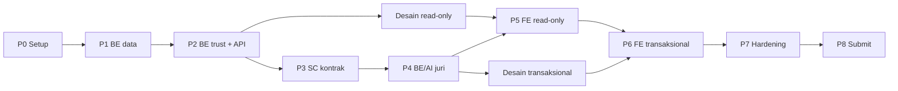

# 08 — Rencana Kerja Solo (kapan pindah SC, BE, FE)

Rencana ini disusun per **fase dengan gate**, bukan per jam. Pindah peran hanya dilakukan setelah gate fase sebelumnya lolos. Ukuran relatif: **S** kecil, **M** sedang, **L** besar.

---

## 1. Prinsip kerja solo

1. **Antarmuka dulu, kode kemudian.** Signature method kontrak (`04`) dan tipe API (`05`) adalah kontrak antar-lapisan. Kalau perlu berubah: ubah dokumen + `packages/shared` dulu, baru kode.
2. **Pindah peran hanya di gate.** Bila tersangkut lebih dari satu sesi di tengah fase, catat blocker di `docs/devlog.md`, lalu kerjakan tugas independen berikutnya di fase yang sama.
3. **Catatan serah-terima setiap pindah peran.** Tulis 5 baris di `docs/devlog.md`: selesai apa, berikutnya apa, antarmuka yang berubah, blocker, perintah untuk menjalankan.
4. **Thin slice secepatnya.** Setelah kontrak jalan, buat irisan tipis end-to-end (CLI create job → runner dengan provider `recorded` → finalize) sebelum memoles apa pun.
5. **Data nyata sejak awal.** Fase 1 sengaja ditaruh paling depan karena angka nyata adalah bukti masalah dan bahan demo.
6. **Kerjakan desain Pencil saat menunggu.** Deploy testnet, eval LLM, dan sync data sering memakan waktu tunggu; pakai untuk desain halaman.

---

## 2. Peta perpindahan peran

| Fase | Peran utama | Ukuran | Masuk bila | Gate keluar | Artefak serah-terima |
|---|---|---|---|---|---|
| P0 Setup & spike | DevOps + BE | M | Mulai proyek | G0 | `docs/phase0-findings.md`, akun testnet, repo + tag `pre-hackathon` |
| P1 Data layer | **BE** | L | G0 | G1 | Snapshot nyata + metrik M1–M5 |
| P2 Trust engine + read API | **BE** | M | G1 | G2 | API read-only + tipe di `packages/shared` (**freeze #1**) |
| *(desain)* | Desain di Pencil | M | G2 (bentuk data sudah jelas) | Desain halaman 2.1–2.7, 2.12 siap | File Pencil |
| P3 Smart contract | **SC** | L | G2 | G3 | Kontrak di testnet, ABI, util commitment TS (**freeze #2**) |
| P4 Compiler + jury runner | **BE/AI** | L | G3 | G4 | Job testnet dinilai otomatis oleh 3 model; eval v1 |
| *(desain)* | Desain di Pencil | S | Saat menunggu eval di P4 | Desain halaman 2.8–2.11 siap | File Pencil |
| P5 Frontend read-only | **FE** | M | G4 dan desain read-only siap | G5 | Halaman read-only dengan data nyata |
| P6 Frontend transaksional | **FE + SC integrasi** | L | G5 | G6 | Seluruh alur UF2–UF5 lewat UI |
| P7 Hardening & eval | Semua | M | G6 | G7 | Mode RECORDED, Docker, README, eval final |
| P8 Submission | Docs + marketing | S | G7 | Submit | Video, post X, deskripsi, tag `hackathon-submission` |

**Kenapa urutannya BE → SC → BE/AI → FE?**
- BE data dulu: membuktikan masalah dan memberi bentuk data untuk desain.
- SC sebelum jury runner: runner bergantung pada method dan format commitment kontrak.
- FE read-only sebelum transaksional: sudah ada sesuatu yang bisa didemokan lebih awal.



---

## 3. Detail fase

### P0 — Setup & spike (DevOps + BE) · M

- [x] T0.1 Buat repo publik, LICENSE MIT, struktur monorepo (03 §8), commit awal → tag `pre-hackathon`.
- [x] T0.2 Salin paket dokumen ini ke `docs/`.
- [x] T0.3 Daftarkan agent Juri di market (`POST /v1/agents/register`), simpan `MARKET_API_KEY`; jelajahi Swagger; jawab V1, V2, V3, V5, V9. Selesai 2026-11-14: agent "Assay" (draft) dibuat pemilik lewat web, token di `.env`; hasil probe GET di phase0-findings V1/V5 (bid job lain 401).
- [x] T0.4 Uji NearBlocks v3 `ft-txns` untuk `escrow.ai.near` (V4); simpan contoh response di `docs/samples/`.
- [x] T0.5 Daftar NEAR AI Cloud, ambil API key dan kredit, `GET /v1/models`, uji endpoint attestation dan signature (V6). Bila belum bisa: konfigurasikan provider fallback. Selesai: key aktif; job #8 dinilai 3 model nearai dengan attestation TEE yang tanda tangannya valid.
- [x] T0.6 Buat akun testnet: `<you>`, `juri.<you>`, `keeper.<you>`, `demo-requester.<you>`, `demo-worker-honest.<you>`, `demo-worker-injector.<you>`.
- [x] T0.7 Spike kontrak kecil yang membuat sub-account + FCAK (V7); catat signature near-sdk yang benar.
- [x] T0.8 Cek `wrap.testnet` (V8).
- [x] T0.9 GitHub Actions kerangka: lint + test kosong.

**Gate G0:** `docs/phase0-findings.md` menjawab V1–V9 (atau mencatat fallback yang dipilih); spike FCAK sub-account berhasil di testnet.

---

### P1 — Data layer (BE) · L

- [x] T1.1 `packages/shared`: tipe dasar + schema zod untuk Job, Bid, Agent, Transfer.
- [x] T1.2 Skema SQLite (Drizzle) + migrasi untuk tabel di 05 §2.
- [x] T1.3 `sync-market`: pagination, backoff, idempoten, `sync_state` (FR-A1).
- [x] T1.4 `index-escrow`: cursor NearBlocks, klasifikasi `kind` + `kind_method` (FR-A2).
- [x] T1.5 `snapshot:export` / `snapshot:import` + sha256 (FR-A4).
- [x] T1.6 Hitung M1–M5 + `sources_json` (FR-A3).
- [x] T1.7 Uji manual: cocokkan 3 job dan 3 tx dengan halaman aslinya; catat di `docs/devlog.md`.

**Gate G1:** `pnpm sync && pnpm metrics` mencetak angka nyata; snapshot pertama ter-commit; uji manual cocok.

---

### P2 — Trust engine + read API (BE) · M

- [x] T2.1 Pemetaan identitas (FR-B1).
- [x] T2.2 Deteksi bid kembar + cluster (FR-B4) + unit test dengan fixture.
- [x] T2.3 Trust Score ~~ts-0.1~~ **ts-0.2** + gate Insufficient data (FR-B2, FR-B3) + unit test.
- [~] T2.4 Shared funder (FR-B5, SHOULD) — logika + test selesai; fetcher NearBlocks diuji live (`pnpm --filter @juri/workers funder:smoke`: 3 akun mainnet publik, funder ter-resolve). Tetap [~]: 0 dari 691 agent terpetakan ke akun NEAR, jadi belum ada edge shared-funder di data asli (butuh T0.3).
- [x] T2.5 API: `/health`, `/meta`, `/insights`, `/insights/:id/records`, `/jobs`, `/jobs/:id`, `/agents`, `/agents/:id`, `/patterns`, `/patterns/:id`, `/blobs` (FR-H1).
- [x] T2.6 Bekukan tipe response di `packages/shared` (**freeze #1**).
- [~] T2.7 Mulai `eval/patterns-review.md`: review manual top-10 cluster — file dibuat; belum ada cluster (bid privat). Tidak bisa diukur di data asli: dengan token agent pun bid job lain 401 (cek 2026-11-14); satu-satunya jalan adalah memposting job sendiri sebagai pembeli, yang tidak kita lakukan (job palsu membuang waktu agent lain). Detektor tetap teruji di fixture.

**Gate G2:** semua endpoint read mengembalikan data nyata; test scoring dan pattern hijau.

> **Desain (Pencil) — read-only:** setelah G2, desain halaman 2.1–2.7 dan 2.12 dari `07-UI-PAGES-USERFLOW.md` memakai contoh response nyata.

---

### P3 — Smart contract (SC) · L

- [x] T3.1 Tipe dan state (04 §2).
- [x] T3.2 `create_job`, `cancel_job`, `submit_deliverable`, `reclaim_expired` + storage accounting (FR-D1–D4).
- [x] T3.3 `register_verifier` dengan sub-account + FCAK + callback (FR-E1).
- [x] T3.4 `start_judging` + pemilihan juri (FR-D5, FR-E2).
- [x] T3.5 `commit_vote`, `reveal_vote` + format commitment (FR-E6, FR-E7).
- [x] T3.6 `finalize` (tally, fee split, statistik) + `restart_jury` (FR-D6, FR-E10, FR-E11, FR-G1).
- [x] T3.7 `withdraw` + callback, `set_params`, `withdraw_treasury`, view, event, kode error (FR-D7, FR-D10, FR-G2, FR-G3, FR-F1).
- [x] T3.8 Unit test (04 §11) ✅ 60 test; integration test near-workspaces di `contracts/juri-it` (FCAK verifier, lifecycle penuh + withdraw, FCAK ditolak untuk method lain) ✅ 3/3 hijau di CI Linux (run 43590219631). Tidak bisa dijalankan di host Windows (sandbox NEAR tidak ada, tanpa linker MSVC).
- [x] T3.9 Deploy testnet; daftarkan v1–v4; buat FCAK keeper.
- [x] T3.10 Ekspor ABI ke repo; util commitment TS + vektor uji bersama (**freeze #2**).
- [x] T3.11 `scripts/demo-lifecycle.ts` dengan vote manual (tanpa LLM).

**Gate G3:** skrip lifecycle selesai di testnet; FCAK verifier terbukti ditolak saat memanggil method lain; semua test hijau.

---

### P4 — Spec Compiler + jury runner (BE/AI) · L

- [x] T4.1 Abstraksi provider: `nearai`, `openai_compat`, `recorded` (05 §7.6).
- [x] T4.2 Prompt compiler + schema + endpoint `/criteria/compile` + kriteria C0 (FR-C1–C3, FR-C5).
- [x] T4.3 Mesin aturan deterministik + SSRF guard (FR-C2, NFR-SEC-4).
- [x] T4.4 Pre-scan injection (FR-E5).
- [x] T4.5 Prompt judge + evidence schema + override deterministik (FR-E3, FR-E4, FR-E9).
- [x] T4.6 Loop runner + `runner_state` + commit/reveal/finalize via kunci verifier dan keeper (NFR-REL-2).
- [x] T4.7 Attestation capture + cek signature (FR-E8, SHOULD). ✅ NEAR AI Cloud live: report (nonce dicek) + signature ecdsa/ed25519 valid; job #6 dan #7 semua juri attested.
- [x] T4.8 Eval set v1 ≥20 kasus (09 §2); jalankan; rekam output ke `eval/recorded/`; buat `eval/report.md` v1. ✅ 24 kasus live; quorum 24/24, injection false-PASS 0%; replay `--recorded` identik.

**Gate G4:** satu Protected Job di testnet dinilai otomatis oleh 3 model berbeda sampai `Settled`; eval v1 terbit. ✅ **Lulus** 2026-11-13 (job #7 Released, #6 Refunded + injection flag; `eval/report.md`).

> **Desain (Pencil) — transaksional:** saat eval berjalan, desain halaman 2.8–2.11, terutama panel Jury di 2.9.

---

### P5 — Frontend read-only (FE) · M

- [x] T5.1 Scaffold Next.js 15 + Tailwind v4 manual (create-near-app diblokir di sesi ini; wallet ditambahkan di P6), layout, navbar dengan badge mode (FR-A6).
- [x] T5.2 Klien API bertipe dari `packages/shared` (`apps/web/lib/api.ts`).
- [x] T5.3 Halaman `/`, `/insights` + Source drawer (FR-A5).
- [x] T5.4 `/jobs`, `/jobs/[id]` termasuk **Generate criteria** (memanggil `/api/criteria/compile` P4).
- [x] T5.5 `/agents`, `/agents/[id]`, `/patterns/[id]` (FR-B6, FR-B8).
- [x] T5.6 `/methodology` (FR-I5). Bonus read-only dari kontrak: `/protected`, `/jury`.
- [x] Cek visual mobile (390px) dan pakai `CriteriaDocSchema` dari shared (freeze #3).
- [ ] Grafik insights (butuh endpoint data seri dari API) — dipindah ke P7 bila sempat.

**Gate G5:** semua halaman read-only berjalan dengan data nyata pada mode SNAPSHOT; loading/empty/error state ada.

---

### P6 — Frontend transaksional (FE + integrasi SC) · L

- [x] T6.1 Wallet connect/disconnect, deteksi peran (FR-I1, FR-I4). NEAR Wallet Selector (Meteor, MyNearWallet, Intear); diuji dengan wallet Meteor asli di testnet.
- [x] T6.2 Wizard `/protected/new` 4 langkah (FR-C4, FR-D1). Diuji end-to-end: job #8 didanai lewat Meteor, dijuri, Released.
- [~] T6.3 `/protected/[jobId]`: timeline, panel juri live, modal submit, drawer evidence/attestation, Verify hash (FR-I2, FR-I3, NFR-VERIF-2). Teruji di browser pada job #7/#8 (Verify hash kriteria + deliverable + evidence/attestation cocok on-chain); form submit belum ditandatangani dengan wallet asli.
- [~] T6.4 `/protected`, `/account` dengan Withdraw. `/account`: claimable + Withdraw, get_agent_stats, job per peran, Cancel/Reclaim; Withdraw belum ditandatangani dengan wallet asli.
- [ ] T6.5 `/jury` tab Verifiers dan Parameters; Treasury (SHOULD).
- [x] T6.6 Pemetaan kode error kontrak → pesan ramah (`apps/web/lib/wallet/errors.ts`, E01–E23 + penolakan wallet, saldo, gas, RPC; `components/tx-modal.tsx`).

**Gate G6:** UF2–UF5 berhasil lewat UI di testnet, termasuk skenario injection (W10).

---

### P7 — Hardening & eval (semua) · M

- [x] T7.1 Mode RECORDED-JURY + `pnpm e2e` di sandbox (near-workspaces) memakai output terekam.
  `services/workers/src/e2e.ts` (npm `near-sandbox` 0.3.4): deploy wasm → 3 verifier FCAK → 2 job dari eval (`j1-economics-V1` → Released, `-V5` injeksi → Refunded) → runner `tick()` asli → withdraw. Juri memutar ulang `eval/recorded/` lewat `e2e-replay.ts` (hanya id juri + nonce delimiter yang dipetakan; unit test di Windows hijau). Linux/macOS saja; dijalankan di CI job `e2e`, hijau pada run 43592472699 (#1 Released 6/6 PASS, #2 Refunded inj=true 3/3, withdraw worker/requester/verifier → claimable 0).
- [ ] T7.2 `docker-compose.yml`; deploy API + workers; deploy FE.
- [~] T7.3 Rate limit, validasi ukuran, SSRF test, scan secret di bundle FE (NFR-SEC-1, NFR-SEC-3, NFR-SEC-4).
  `services/api/src/security.test.ts` (10 tes): limit GET/blobs/compile + 429 Retry-After; X-Forwarded-For palsu tidak lagi bisa membuka bucket baru (`TRUST_PROXY`, default 0); body >1 MB ditolak walau tanpa Content-Length (hono `bodyLimit`), compile ≤64 KB; deliverable ≤50.000 char; blob criteria wajib CriteriaDoc valid (≤13 kriteria, ≤500 char). SSRF (`packages/jury`): **bug diperbaiki** — `[::ffff:10.0.0.1]` dinormalisasi URL jadi `::ffff:a00:1` dan dulu lolos sebagai publik; sekarang IPv6 di-expand penuh (mapped/compatible/6to4/Teredo/NAT64 diblok); fetch deliverable `httpsOnly` (juga setelah redirect). Bundle: `pnpm scan:bundle` (pola kunci + nama env rahasia + nilai env asli), CI job `web-bundle`. Kontrak sudah membatasi URI ≤512 dan ≤13 kriteria. Sisa: saat deploy (T7.2) cek header XFF Vercel→Railway lalu set `TRUST_PROXY` (1 atau 2) supaya semua user tidak berbagi satu bucket IP Vercel; tandai [x] setelah CI hijau.
- [ ] T7.4 Eval final + review pattern final; isi angka ke README.
- [ ] T7.5 README lengkap + tabel "claim → bukti" (09 §3).
- [ ] T7.6 `skill.md` + `examples/agent-requester.ts` (SHOULD).
- [ ] T7.7 Uji clone bersih di container baru: ≤5 perintah (NFR-REPRO-1).

**Gate G7:** clone bersih → demo SNAPSHOT dan `pnpm e2e` jalan tanpa key; CI hijau.

---

### P8 — Submission · S

- [ ] T8.1 Rekam video 60–90 detik (09 §6).
- [ ] T8.2 Post demo di X (kamu sendiri yang memposting) dengan tag @NEARProtocol dan #NEARHackathon.
- [ ] T8.3 Tag `hackathon-submission`; tautkan diff `pre-hackathon...hackathon-submission` di README.
- [ ] T8.4 Isi form submission: nama, lead, email, ukuran tim (1), track, akun NEAR mainnet untuk hadiah, repo, link post X, deskripsi (09 §5).
- [ ] T8.5 Cek repo publik dan bisa dibuka tanpa login.

---

## 4. Daftar potong (bila scope perlu dikurangi)

Potong dari atas ke bawah. Item di bagian "Jangan dipotong" adalah inti demo.

| Urutan | Item | Requirement |
|---|---|---|
| 1 | Banding, slashing, NEAR Intents, IPFS | FR-E14, FR-E13, COULD |
| 2 | Verifikasi attestation penuh (NRAS + TDX) | COULD |
| 3 | Partial payout | FR-D9 |
| 4 | wNEAR / NEP-141 | FR-D8 |
| 5 | Root snapshot on-chain | FR-F2 |
| 6 | Halaman Treasury | FR-G4 |
| 7 | `skill.md` + contoh agent | FR-H2, FR-H3 |
| 8 | Shared funder | FR-B5 |
| 9 | AI summary Trust Score | FR-B7 |

**Jangan dipotong:** data nyata + metrik ber-sumber (FR-A1–A6), Trust Score + bid kembar (FR-B1–B4, B6, B8), Spec Compiler (FR-C1–C5), lifecycle kontrak (FR-D1–D7, D10), juri 3 model + commit-reveal + injection (FR-E1–E7, E9–E12), mode SNAPSHOT/RECORDED + README repro.

---

## 5. Git dan pelacakan

- Branch per fase: `p1-data`, `p3-contract`, dst.; merge ke `main` saat gate lolos.
- Commit memakai Conventional Commits (`feat(sc): commit_vote`, `fix(be): backoff`).
- Tag: `pre-hackathon` (commit awal), `g1`…`g7` (opsional, penanda gate), `hackathon-submission` (final).
- Papan Kanban (GitHub Projects): kolom **Backlog · Next · Doing · Review · Done**; satu kartu = satu Task ID (T0.1 dst.) dengan label peran `SC`/`BE`/`AI`/`FE`/`OPS`.
- `docs/devlog.md`: catatan serah-terima setiap pindah peran (prinsip 3).

### Template catatan serah-terima

```
## <tanggal> — keluar dari <peran>, masuk ke <peran>
- Selesai: …
- Berikutnya: …
- Antarmuka berubah: … (sudah diperbarui di docs/04 atau 05? ya/tidak)
- Blocker: …
- Cara menjalankan: pnpm …
```
